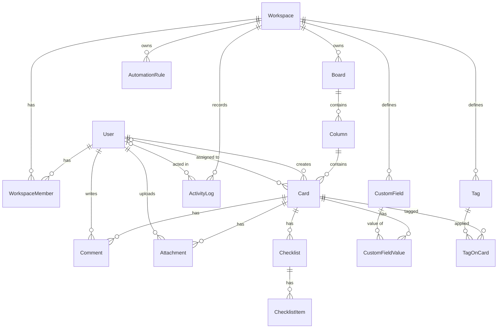

# Database Design Document

**System:** Collaborative Real-Time Workflow & Kanban Suite
**Status:** Draft v0.1
**Canonical schema:** [`packages/database/prisma/schema.prisma`](../packages/database/prisma/schema.prisma)
**Related documents:** [README](../README.md) · [Technical Architecture Document](technical-architecture.md)

The Prisma schema file is the source of truth. This document explains it. If the two disagree, the schema file wins and this document should be corrected.

---

## 1. Overview

- **Engine:** PostgreSQL 15 or later, accessed through Prisma ORM.
- **Identifiers:** `cuid()` strings for all primary keys.
- **Tenancy:** Shared database, shared schema. The `Workspace` is the tenant boundary and every tenant-owned row is reachable from a workspace.
- **Ordering:** Boards, columns, and cards carry a Lexorank `position` string.
- **Timestamps:** Most entities carry `createdAt`; mutable entities also carry `updatedAt`.

---

## 2. Entity-Relationship Diagram

---

## 3. Enumerations

| Enum | Values | Purpose |
| --- | --- | --- |
| `Role` | `OWNER`, `ADMIN`, `MEMBER`, `VIEWER` | Workspace permission tier |
| `Priority` | `LOW`, `MEDIUM`, `HIGH`, `URGENT` | Card priority (default `MEDIUM`) |
| `CustomFieldType` | `TEXT`, `NUMBER`, `SELECT`, `MULTI_SELECT`, `DATE`, `CHECKBOX`, `USER` | Defines how a custom field's value is interpreted |

---

## 4. Entity Reference

### 4.1 Identity and tenancy

| Entity | Purpose | Key fields and constraints |
| --- | --- | --- |
| `User` | A person with an account | `email` unique |
| `Workspace` | The tenant | `slug` unique |
| `WorkspaceMember` | Joins a user to a workspace with a role | `@@unique([userId, workspaceId])`; `role` defaults to `MEMBER` |

### 4.2 Board hierarchy

| Entity | Purpose | Key fields and constraints |
| --- | --- | --- |
| `Board` | A Kanban board in a workspace | `position` (Lexorank); belongs to a workspace |
| `Column` | A lane on a board | `position` (Lexorank); belongs to a board |
| `Card` | A unit of work | `position` (Lexorank); `priority`; optional `dueDate`, `description`, `assigneeId`; required `creatorId` |

### 4.3 Card detail

| Entity | Purpose | Key fields and constraints |
| --- | --- | --- |
| `Comment` | A comment on a card | `content`; author and card required |
| `Attachment` | A file attached to a card | `fileName`, `fileUrl`, `mimeType`, `sizeBytes`; stores metadata and a reference only, not file bytes |
| `Checklist` | A titled checklist on a card | Contains `ChecklistItem` rows |
| `ChecklistItem` | One checklist entry | `content`, `isCompleted` (default `false`) |
| `Tag` | A workspace-scoped label | `@@unique([workspaceId, name])`; `color` |
| `TagOnCard` | Joins tags to cards | Composite primary key `[cardId, tagId]` |

### 4.4 Custom fields

| Entity | Purpose | Key fields and constraints |
| --- | --- | --- |
| `CustomField` | A field definition scoped to a workspace | `fieldType` (enum); `options` string array for `SELECT` and `MULTI_SELECT` |
| `CustomFieldValue` | A card's value for one field | `@@unique([cardId, customFieldId])`; `value` is `Json` |

`value` shape by `fieldType`:

| `fieldType` | JSON shape of `value` |
| --- | --- |
| `TEXT` | string |
| `NUMBER` | number |
| `SELECT` | string, one of `options` |
| `MULTI_SELECT` | array of strings, each from `options` |
| `DATE` | ISO 8601 string |
| `CHECKBOX` | boolean |
| `USER` | user ID string |

The database does not enforce these shapes. The service layer validates each value against the field's type with Zod before writing.

### 4.5 Automation and audit

| Entity | Purpose | Key fields and constraints |
| --- | --- | --- |
| `AutomationRule` | A trigger and action definition | `triggerType`, `triggerConfig` (Json), `actionType`, `actionConfig` (Json), `isActive` default `true` |
| `ActivityLog` | Append-only audit record | `action`, `entityType`, `entityId`, optional `details` (Json); nullable `actorId`; `@@index([workspaceId, createdAt])` |

Known values for `triggerType` include `CARD_MOVED`, `CARD_CREATED`, and `DUE_DATE_APPROACHING`. Known values for `actionType` include `REASSIGN`, `SEND_WEBHOOK`, and `CHANGE_PRIORITY`. These are plain strings in the schema; the set is enforced in application code and may later be promoted to enums.

---

## 5. Relationships and Delete Behavior

| Parent | Child | On parent delete |
| --- | --- | --- |
| `Workspace` | Members, boards, custom fields, tags, rules, activity logs | Cascade |
| `Board` | `Column` | Cascade |
| `Column` | `Card` | Cascade |
| `Card` | Comments, attachments, checklists, field values, tag links | Cascade |
| `Checklist` | `ChecklistItem` | Cascade |
| `Tag`, `CustomField` | Their link and value rows | Cascade |
| `User` | `WorkspaceMember`, `Comment`, `Attachment` | Cascade |
| `User` (as actor) | `ActivityLog.actorId` | Set to null |
| `User` (as assignee) | `Card.assigneeId` | Prisma default for an optional relation: set null |
| `User` (as creator) | `Card.creatorId` | Prisma default for a required relation: restrict |

Design implications to be aware of:

- Deleting a user cascades to the comments and attachments they authored, which removes content other people may rely on. Most deployments should deactivate users rather than delete them. If hard deletion is required, consider changing these relations to preserve content and anonymize the author.
- Because `Card.creatorId` restricts deletion, a user who created cards cannot be hard-deleted until those cards are reassigned or removed.
- Deleting a workspace cascades through the entire tenant, including its audit log. This is a destructive operation that should be restricted to `OWNER` and ideally protected by a soft-delete or grace period **(open)**.

---

## 6. Integrity Rules Not Enforced by the Database

The schema cannot express the following, so services must enforce them and tests must cover them:

1. A card's assignee must be a member of the card's workspace.
2. A tag applied through `TagOnCard` must belong to the same workspace as the card.
3. A `CustomFieldValue` must reference a field in the same workspace as the card, and its `value` must match the field's `fieldType`.
4. A `SELECT` or `MULTI_SELECT` value must come from the field's `options`.
5. A `USER` field value must reference a member of the workspace.
6. `position` values within a parent must be unique and correctly ordered. Concurrent writes can briefly collide; the server resolves collisions (see the [TAD](technical-architecture.md#75-ordering-and-conflict-handling)).
7. `ActivityLog` rows are never updated or deleted by application code.

---

## 7. Indexing

### 7.1 Declared in the schema

- Primary keys on every table.
- Unique: `User.email`, `Workspace.slug`, `WorkspaceMember(userId, workspaceId)`, `CustomFieldValue(cardId, customFieldId)`, `Tag(workspaceId, name)`.
- Composite primary key: `TagOnCard(cardId, tagId)`.
- `ActivityLog(workspaceId, createdAt)`.

### 7.2 Recommended additions

PostgreSQL does not index foreign key columns automatically. The following are not yet in the schema and should be added as the corresponding queries are implemented:

| Index | Supports |
| --- | --- |
| `Board(workspaceId, position)` | Listing boards in order |
| `Column(boardId, position)` | Rendering a board's lanes in order |
| `Card(columnId, position)` | Rendering a column's cards in order (hottest query) |
| `Card(assigneeId)` | "My cards" views and assignee filters |
| `Card(dueDate)` | Due-date automation scans |
| `Comment(cardId, createdAt)` | Comment threads |
| `Attachment(cardId)` | Card detail loading |
| `AutomationRule(workspaceId, triggerType, isActive)` | Rule lookup when an event fires |
| `WorkspaceMember(workspaceId)` | Member lists (the existing unique index leads with `userId`) |
| `TagOnCard(tagId)` | Filtering cards by tag |
| `ActivityLog(workspaceId, entityType, entityId)` | Per-entity history |

Each addition should be justified against a real query plan before merging.

---

## 8. Ordering with Lexorank

- `position` is a lexicographically sortable string. Sorting by it, within a parent, returns display order.
- A move computes a string between its new neighbors and updates only the moved row.
- Positions must use a binary-safe collation (such as `C`) so database ordering matches the client's comparison. A locale-aware collation can sort differently and must not be used for these columns.
- When no midpoint exists, or keys grow beyond a length threshold, the server rebalances the affected parent's children and broadcasts the new positions.
- Ordering is scoped: cards within a column, columns within a board, boards within a workspace.

---

## 9. Transactions and Consistency

- Any mutation that also writes an `ActivityLog` row runs in a single `prisma.$transaction`.
- Writing custom field values together with other card changes runs in one transaction.
- Automation actions applied by workers use the same transactional pattern, with `actorId` null and the rule recorded in `details`.
- Optimistic concurrency uses `updatedAt` on `Card`: a write with a stale value is rejected as a conflict.

---

## 10. Migrations and Environments

- Local development may use `db:push` for rapid iteration.
- Shared environments use reviewed migrations created with `db:migrate`. Migrations are committed to the repository.
- Migrations must be backward compatible with the previously deployed application version, using an expand-then-contract approach for destructive changes (add new, migrate data, switch code, remove old).
- Seed data (`db:seed`) creates a mock workspace for development and test environments only.

---

## 11. Data Protection and Retention

- The application database role is granted only the privileges it needs. It should not hold `UPDATE` or `DELETE` on `ActivityLog`.
- Personal data lives in `User` (email, name, avatar URL) and in free-text content. Any data export or erasure process must account for comments, attachments, and audit details.
- Backups, point-in-time recovery, and restore drills are described in the [TAD](technical-architecture.md#11-reliability-and-disaster-recovery).
- Retention periods for `ActivityLog` and the need for soft deletes are undecided **(open)**.

---

## 12. Change Log

| Version | Change |
| --- | --- |
| 0.1 | Initial document, derived from the README schema. Added `Attachment`, workspace-scoped `Tag`, `ActivityLog.actorId`, `CustomFieldType` enum, and `Json` field values. |
