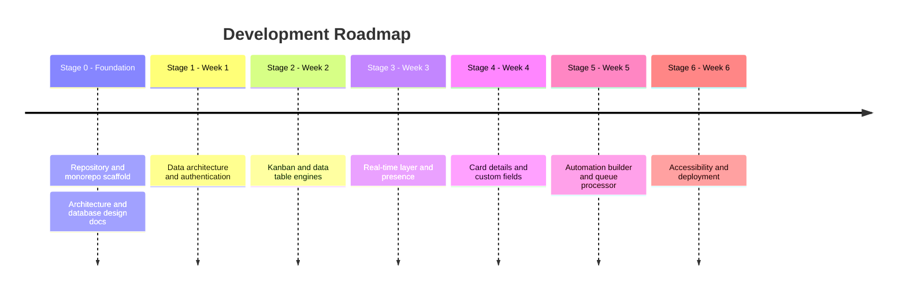
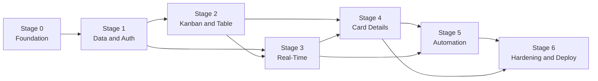

# Development Roadmap

**System:** Collaborative Real-Time Workflow & Kanban Suite
**Status:** Draft v0.1
**Related documents:** [README](../README.md) · [Technical Architecture Document](technical-architecture.md) · [Database Design Document](database-design.md)

This roadmap breaks the build into a completed foundation stage and six weekly stages. Tick a box when the item is merged and meets the stage's exit criteria. The week boundaries are planning targets, not commitments.

---

## Overview

### Stage dependencies

### Standing requirements for every stage

These apply to all items below and are part of each stage's definition of done:

- [ ] Code follows the rules in the project's agent instructions: strict TypeScript with no `any`, SOLID structure, and enterprise-grade comments.
- [ ] Inbound payloads are validated with Zod schemas from `packages/shared-types`.
- [ ] Every write path enforces RBAC and workspace scoping.
- [ ] Unit tests cover new logic, and integration tests cover new endpoints and handlers.
- [ ] Any new diagram is Mermaid, and affected docs under `docs/` are updated.

---

## Stage 0: Foundation (complete)

**Goal:** A documented, scaffolded repository ready for feature work.

- [x] Create the GitHub repository
- [x] Write the README and agent instructions
- [x] Scaffold the monorepo folder structure
- [x] Add root config: `package.json`, `pnpm-workspace.yaml`, `turbo.json`, `.gitignore`
- [x] Add `docker-compose.yml` for PostgreSQL and Redis
- [x] Add `.env.example` files for `apps/web` and `apps/api-server`
- [x] Write the Technical Architecture Document
- [x] Write the Database Design Document
- [x] Add the Prisma schema file

---

## Stage 1: Data Architecture & Authentication (Week 1)

**Goal:** A working database, authenticated API, and the application shell.

### Tooling and workspace setup
- [x] Add TypeScript base config (`strict: true`) and per-package `tsconfig` files with `@/` aliases
- [x] Configure ESLint and Prettier across the monorepo
- [x] Wire `dev`, `build`, `lint`, and `test` scripts in each workspace so Turborepo can run them
- [x] Choose and configure the unit test runner (Vitest)
- [x] Add startup environment validation with Zod (fail fast on bad config)

### Database
- [x] Add Prisma and the generated client to `packages/database`
- [x] Add `db:push`, `db:migrate`, `db:generate`, and `db:seed` scripts
- [x] Create the initial migration from `schema.prisma`
- [x] Add the recommended indexes from the database design doc that Stage 1 queries need
- [x] Set binary-safe collation on all `position` columns
- [x] Write the seed script: a mock workspace, members in every role, a board, columns, and cards
- [x] Export a shared Prisma client from `packages/database/src`

### Shared contracts
- [x] Set up `packages/shared-types` with build output consumable by both apps
- [x] Define Zod schemas and inferred types for auth and workspace DTOs
- [x] Define the standard error response shape `{ message, code, details? }`

### API server
- [x] Decide Express or Fastify and record it as an architecture decision
- [x] Create the server entry point with graceful shutdown
- [x] Add liveness and readiness endpoints
- [x] Add centralized error-handling middleware
- [x] Add structured logging with request IDs
- [x] Implement registration and login endpoints
- [x] Implement JWT issuance and verification middleware
- [x] Decide token lifetime, refresh, and revocation, then implement it
- [x] Implement workspace resolution middleware
- [x] Implement RBAC middleware enforcing `OWNER`, `ADMIN`, `MEMBER`, and `VIEWER`
- [x] Implement workspace create, list, and switch endpoints
- [x] Implement member invite and role-change endpoints
- [x] Write audit entries for role changes within the same transaction

### Web application
- [x] Initialize Next.js (App Router) with Tailwind and shadcn/ui
- [ ] Set up the TanStack Query provider and client
- [ ] Build `(auth)` routes: login, register, invite
- [ ] Build the protected `(dashboard)/[workspaceSlug]` layout shell
- [ ] Build the workspace switcher
- [ ] Build the command palette shell (`Cmd+K`) with navigation commands

### Exit criteria
- [x] A new user can register, create a workspace, and invite a member
- [x] Negative tests exist for every role and endpoint pair
- [x] A cross-tenant access attempt is rejected and tested
- [ ] `pnpm dev`, `pnpm build`, `pnpm lint`, and `pnpm test` all pass from a clean clone

---

## Stage 2: Kanban & Data Table Engines (Week 2)

**Goal:** Boards, columns, and cards with ordered drag-and-drop, plus a table view over the same data.

### Ordering
- [ ] Implement the Lexorank utilities in `apps/web/lib` (midpoint, before, after, first, last)
- [ ] Implement the matching server-side validation and collision handling
- [ ] Implement rebalancing for a parent's children when no midpoint exists or keys grow too long
- [ ] Unit-test boundaries: empty list, single item, adjacent keys, repeated insertion in one gap

### API
- [ ] CRUD endpoints for boards, columns, and cards, all workspace-scoped
- [ ] Move endpoint that accepts only the moved item's new `position`
- [ ] Paginated card queries and a board-load endpoint
- [ ] Optimistic concurrency check on card writes using `updatedAt`
- [ ] Audit entries written in the same transaction as each mutation

### Kanban UI
- [ ] Board list and board page (Server Component initial fetch)
- [ ] Column and card components in `components/kanban/`
- [ ] Column reordering with `@dnd-kit/sortable`
- [ ] Card reordering within a column
- [ ] Card movement across columns
- [ ] Optimistic updates with snapshot and rollback via `setQueryData`
- [ ] Error toast on rollback
- [ ] Create, rename, and delete flows for boards, columns, and cards

### Table view
- [ ] Board view toggle between Kanban and table, stored in Zustand
- [ ] TanStack Table with column visibility toggles
- [ ] Multi-column sorting
- [ ] Multi-facet filtering by tag and assignee
- [ ] Pagination
- [ ] Inline cell editing for title, assignee, due date, and priority
- [ ] CSV export

### Exit criteria
- [ ] A move changes exactly one row in the database
- [ ] A failed move rolls the UI back to the previous state
- [ ] Concurrent moves into the same gap resolve to a consistent order
- [ ] The Kanban and table views stay in sync from one query cache

---

## Stage 3: Real-Time Layer & Presence (Week 3)

**Goal:** Multiple users see each other's changes and activity live, across more than one server instance.

### Gateway
- [ ] Set up the Socket.io server and decide whether it runs in the API process or separately
- [ ] JWT authentication in the connection handshake
- [ ] Implement `room:join` with membership and role verification
- [ ] Join sockets to `workspace:<id>` and `board:<id>` rooms only
- [ ] Evict sockets from rooms when membership or role changes
- [ ] Validate every inbound event payload with Zod and reject failures
- [ ] Per-socket rate limiting for high-frequency events
- [ ] Wire `@socket.io/redis-adapter` and verify cross-instance delivery

### Events
- [ ] Define payload schemas for all events in `packages/shared-types`
- [ ] Implement `card:move` with persistence, audit, and broadcast
- [ ] Broadcast `card:updated` to other clients in the board room
- [ ] Implement `presence:update`
- [ ] Implement `field:lock` claim and release
- [ ] Implement reconnection recovery: invalidate and refetch board queries

### Presence and locks
- [ ] Store presence in Redis with heartbeat-refreshed TTLs
- [ ] Store field locks in Redis with owner and TTL, releasing on disconnect
- [ ] Throttle cursor updates on the client and keep them ephemeral

### Client
- [ ] `useSocket`, `useKanban`, and `usePresence` hooks
- [ ] Online member avatars on the board
- [ ] Live cursor layer in `components/real-time/`
- [ ] Remote card moves applied to the query cache without flicker
- [ ] Visual lock indicators on fields being edited
- [ ] Connection status indicator

### Exit criteria
- [ ] Two clients on different gateway instances see each other's moves
- [ ] A crashed client's presence and locks expire automatically
- [ ] No event reaches a socket outside its authorized rooms, with a test proving it
- [ ] Reconnection restores a correct board state

---

## Stage 4: Card Details & Custom Fields (Week 4)

**Goal:** Rich card detail, comments, attachments, tags, and workspace-defined custom fields.

### Card detail
- [ ] Slide-over `Sheet` for card detail
- [ ] Description editing with sanitized rich text
- [ ] Comment thread: create, list, and delete
- [ ] Checklists: create, add items, toggle, and progress bar
- [ ] Attachments: upload, list, and delete
- [ ] Per-card activity feed from `ActivityLog`

### Attachments backend
- [ ] Choose the storage backend and record the decision
- [ ] Signed upload and download URLs
- [ ] Enforce type and size limits
- [ ] Clean up stored files when attachments or cards are deleted

### Tags
- [ ] Workspace-scoped tag CRUD
- [ ] Apply and remove tags on cards
- [ ] Enforce that a tag and card share a workspace

### Custom fields
- [ ] Field-definition CRUD in workspace settings
- [ ] Field type registry: one handler per `CustomFieldType` for validation, storage, and rendering
- [ ] Support `TEXT`, `NUMBER`, `SELECT`, `MULTI_SELECT`, `DATE`, `CHECKBOX`, and `USER`
- [ ] Validate each value against its field type before writing
- [ ] Write field values and card changes in one transaction
- [ ] Render custom fields in the card sheet, table columns, and filters
- [ ] Field builder UI in `settings/`

### Optimistic updates
- [ ] Apply the optimistic pattern with rollback to comments, checklists, tags, and field edits
- [ ] Reconcile real-time `card:updated` events with in-flight optimistic changes

### Exit criteria
- [ ] Adding a new field type requires adding a handler, not editing existing branching code
- [ ] Invalid field values are rejected server-side with a typed error
- [ ] Cross-workspace tag and field references are rejected and tested

---

## Stage 5: Visual Automation Builder & Queue Processor (Week 5)

**Goal:** Users build trigger and action rules visually, and workers execute them reliably.

### Queue infrastructure
- [ ] Set up BullMQ queues and a worker process type
- [ ] Deterministic job IDs for idempotency
- [ ] Retry with exponential backoff and a bounded attempt count
- [ ] Dead-letter queue and a way to inspect failures
- [ ] Authenticated internal queue dashboard
- [ ] Worker graceful shutdown

### Rule engine
- [ ] Rule CRUD endpoints, restricted to `ADMIN` and above
- [ ] Trigger registry: `CARD_CREATED`, `CARD_MOVED`, `DUE_DATE_APPROACHING`
- [ ] Action registry: `REASSIGN`, `CHANGE_PRIORITY`, `SEND_WEBHOOK`
- [ ] Validate `triggerConfig` and `actionConfig` with Zod per type
- [ ] Enqueue evaluation after commit, never inline in a request
- [ ] Loop protection with a depth counter and a maximum depth
- [ ] Per-workspace rate cap on automation jobs
- [ ] Scheduled scan for due-date triggers
- [ ] Record each automation action in `ActivityLog` with the rule in `details`

### Webhooks
- [ ] Short timeouts and bounded retries
- [ ] Block private and link-local destinations
- [ ] Signed payloads so receivers can verify origin

### Notifications
- [ ] Publish `automation:triggered` to the board room after a rule runs
- [ ] Notification email job

### Visual builder
- [ ] React Flow canvas in `components/canvas/`
- [ ] Trigger and action node types with configuration forms
- [ ] Connect nodes and validate that the graph is a legal rule
- [ ] Save and load rules, with an active/inactive toggle
- [ ] Show recent execution history per rule

### Exit criteria
- [ ] Moving a card to a column fires the matching rule exactly once, even on retry
- [ ] A rule cycle is stopped by loop protection and logged
- [ ] A failing webhook does not delay unrelated jobs
- [ ] Adding a new trigger or action requires adding a handler only

---

## Stage 6: Accessibility, Performance & Deployment (Week 6)

**Goal:** A production-ready, accessible, observable, and deployable system.

### Accessibility
- [ ] Keyboard navigation for the board, drag handles, and table grid
- [ ] ARIA roles, labels, and live regions for drag-and-drop and real-time updates
- [ ] Focus management in dialogs, sheets, and the command palette
- [ ] Command palette: board search, card jump, workspace switch, and bulk actions
- [ ] Color contrast and reduced-motion review
- [ ] Automated accessibility checks in CI

### Performance
- [ ] Define performance budgets from the TAD targets
- [ ] Load test the gateway's fan-out and board load
- [ ] Add list virtualization for large boards
- [ ] Review query plans for hot paths and add justified indexes
- [ ] Bundle analysis and code splitting

### Testing
- [ ] Playwright end-to-end tests for the critical user journeys
- [ ] Multi-user concurrent sync tests using multiple browser contexts
- [ ] Complete the RBAC matrix test suite
- [ ] Cross-tenant isolation test suite
- [ ] Dependency and container vulnerability scanning in CI

### Observability
- [ ] Structured logs with correlation IDs across HTTP, socket, and queue
- [ ] Metrics for requests, sockets, event throughput, and queue health
- [ ] Alerts for latency, errors, backlog growth, and dead-letter arrivals

### Deployment
- [ ] Dockerfiles for `web`, `api-server`, and `worker`
- [ ] Choose the hosting platform and record the decision
- [ ] CI pipeline: install, lint, type-check, test, build, scan, publish
- [ ] CD to staging with smoke tests, then promotion to production
- [ ] Backward-compatible migration process for rolling deploys
- [ ] Automated database backups with point-in-time recovery
- [ ] Rehearse a backup restore
- [ ] Production secrets management

### Documentation
- [ ] Update the TAD and database design doc to match what was built
- [ ] Resolve or re-assign every open question in the TAD
- [ ] Operations runbook: deploy, rollback, backup restore, incident response
- [ ] Add the `LICENSE` file referenced by the README

### Exit criteria
- [ ] End-to-end suite passes in CI on every merge
- [ ] Performance budgets are met under load test
- [ ] A staging deploy and a rollback have both been rehearsed
- [ ] No open question in the TAD remains unassigned
