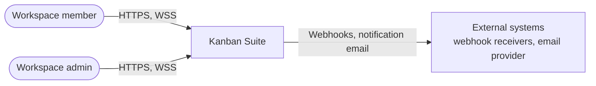
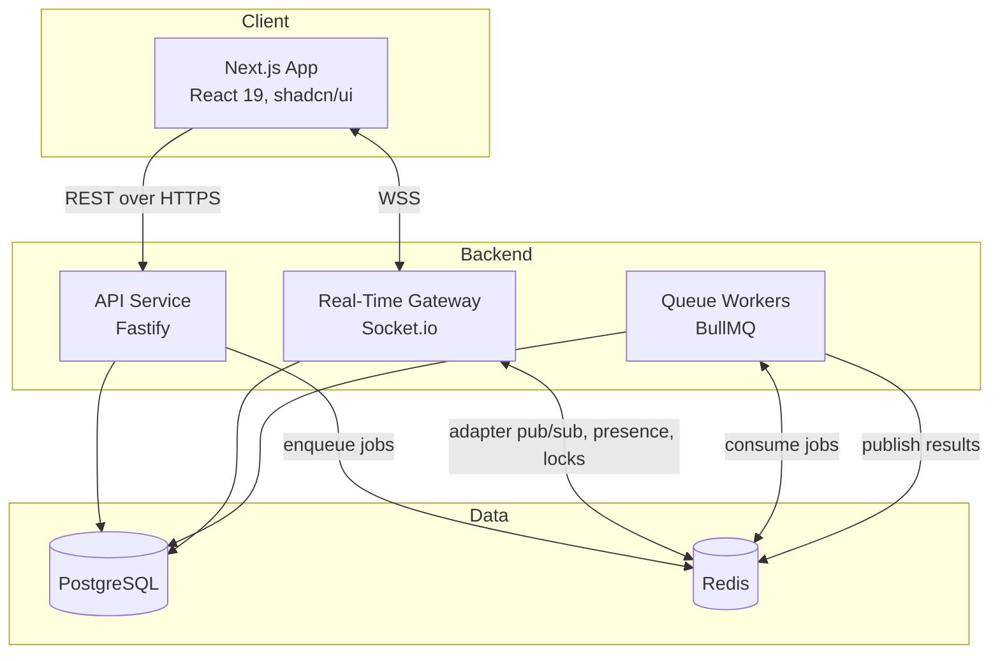
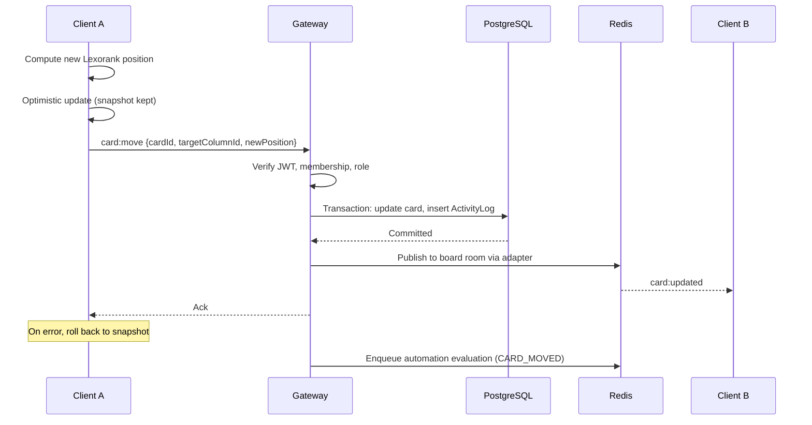
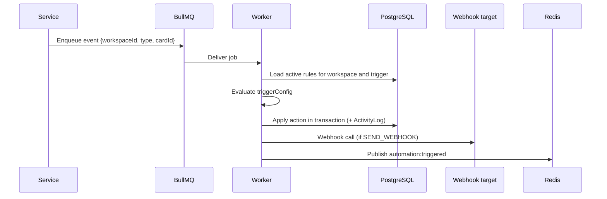

# Technical Architecture Document (TAD)

**System:** Collaborative Real-Time Workflow & Kanban Suite
**Status:** Draft v0.1
**Audience:** Engineering, security review, and operations
**Related documents:** [README](../README.md) · [Database Design Document](database-design.md)

> Values marked **(target)** are proposed design goals to be validated by load testing. They are not measured results. Items marked **(open)** are undecided and tracked in [section 16](#16-open-questions).

---

## Table of Contents

1. [Introduction](#1-introduction)
2. [Architectural Drivers](#2-architectural-drivers)
3. [System Context](#3-system-context)
4. [Solution Overview](#4-solution-overview)
5. [Component Design](#5-component-design)
6. [Key Runtime Flows](#6-key-runtime-flows)
7. [Real-Time Design](#7-real-time-design)
8. [Data Architecture](#8-data-architecture)
9. [Security Architecture](#9-security-architecture)
10. [Scalability and Performance](#10-scalability-and-performance)
11. [Reliability and Disaster Recovery](#11-reliability-and-disaster-recovery)
12. [Observability](#12-observability)
13. [Deployment Architecture](#13-deployment-architecture)
14. [Quality Assurance Strategy](#14-quality-assurance-strategy)
15. [Architecture Decision Records](#15-architecture-decision-records)
16. [Open Questions](#16-open-questions)
17. [Risks](#17-risks)

---

## 1. Introduction

### 1.1 Purpose

This document describes the architecture of the Collaborative Real-Time Workflow & Kanban Suite: its structure, the reasoning behind major decisions, and the rules that keep implementation consistent. It is the reference for design reviews and for onboarding engineers.

### 1.2 Scope

In scope: the web client, API service, real-time gateway, background workers, persistence, and supporting infrastructure.
Out of scope: billing, SSO/SAML federation, native mobile clients, and email deliverability tooling. These may be added later and would extend, not replace, this design.

### 1.3 Definitions

| Term | Meaning |
| --- | --- |
| Workspace | The tenant boundary. All boards, fields, tags, rules, and logs belong to exactly one workspace. |
| Board / Column / Card | The Kanban hierarchy. Each level is ordered by a Lexorank `position`. |
| Lexorank | Fractional string ordering that lets one item move by changing only its own `position`. |
| Room | A Socket.io room. Events are delivered only to sockets joined to the target room. |
| Automation rule | A trigger and action pair evaluated asynchronously by a BullMQ worker. |

---

## 2. Architectural Drivers

### 2.1 Functional drivers

- Multi-tenant workspaces with role-based access control.
- Kanban and table views over the same card data.
- Live presence, cursors, and field-level edit locks.
- Custom fields and a visual automation builder.

### 2.2 Quality attributes

| Attribute | Requirement | Primary tactics |
| --- | --- | --- |
| Responsiveness | Drag-and-drop feels instant; remote clients see a move within about 200 ms at p95 **(target)** | Optimistic updates, single-row writes via Lexorank, WebSocket push |
| Consistency | Concurrent edits converge; no silent lost updates | Server-authoritative ordering, version checks, field locks, reconciliation on reconnect |
| Tenant isolation | No cross-tenant read or write | `workspaceId` scoping on every query, membership checks, room scoping |
| Scalability | Horizontal scaling of API and gateway without sticky-session coupling | Stateless services, Redis adapter, externalized state |
| Availability | 99.9% monthly for API and gateway **(target)** | Redundant instances, health checks, graceful degradation |
| Auditability | Every mutation attributable and tamper-resistant | Append-only `ActivityLog`, written in the same transaction as the mutation |
| Maintainability | Shared contracts between client and server | Monorepo, `shared-types` package, Zod schemas |
| Security | Least privilege, defense in depth | See [section 9](#9-security-architecture) |

### 2.3 Constraints

- Node.js 20 or later, PostgreSQL 15 or later, Redis 7 or later.
- TypeScript in strict mode throughout; `any` is not permitted.
- Turborepo with pnpm workspaces.
- Event names follow the `entity:action` convention.

### 2.4 Assumptions

- Boards typically hold hundreds of cards, not tens of thousands. Very large boards need pagination and virtualization.
- A board has a modest number of concurrent editors (tens, not thousands).
- Identity is managed inside this system for the initial release **(open)**.

---

## 3. System Context



Human users connect through a browser. The system's only outbound integrations are webhook calls and notification email, both issued from background workers, never from request handlers.

---

## 4. Solution Overview

### 4.1 Container view



### 4.2 Technology summary

| Layer | Choice | Notes |
| --- | --- | --- |
| Frontend | Next.js App Router, React 19, Tailwind, shadcn/ui | Server Components for initial data; Client Components for interactivity |
| Client state | TanStack Query v5, Zustand | Query for server state; Zustand for UI-only state |
| Drag and drop | `@dnd-kit` | Optimistic updates with rollback |
| Data grid / canvas | TanStack Table v8, React Flow | |
| API | Node.js 20+, Fastify 5 (ADR-009) | Controllers, services, middleware |
| Real-time | Socket.io with `@socket.io/redis-adapter` | |
| Jobs | BullMQ on Redis | |
| Persistence | PostgreSQL 15+ via Prisma | |
| Build | Turborepo, pnpm | |

### 4.3 Repository layout

The layout is defined in the [README](../README.md#repository-directory-structure). The dependency rule is: `apps/*` may import from `packages/*`; packages never import from apps; `apps/web` and `apps/api-server` never import from each other. Shared contracts live in `packages/shared-types`.

---

## 5. Component Design

### 5.1 Web application (`apps/web`)

- **Rendering:** Server Components fetch initial board data. Client Components handle drag-and-drop, forms, socket subscriptions, and TanStack Query.
- **Server state:** All server data is cached by TanStack Query. Zustand never duplicates server data; it holds sidebar state, view mode, and cursor coordinates only.
- **Optimistic updates:** Every drag-and-drop mutation applies a local change with `queryClient.setQueryData`, keeps the previous snapshot, and rolls back on error.
- **Ordering:** The client computes the Lexorank midpoint between adjacent items and sends one item's new `position`, never array indexes.
- **UI primitives:** shadcn/ui and Radix for all dialogs, sheets, and selects.

### 5.2 API service (`apps/api-server`)

| Layer | Responsibility |
| --- | --- |
| `middlewares/` | Authentication, workspace resolution, RBAC enforcement, request validation, error mapping |
| `controllers/` | HTTP routing and transport concerns only |
| `services/` | Business logic, transactions, automation evaluation, enqueueing jobs |
| `websockets/` | Socket.io gateway and room management |
| `queues/` | BullMQ producers and processors |

Controllers contain no business logic. Services are the only layer that touches Prisma, so a transaction boundary is always explicit.

Errors are returned in one shape:

```json
{ "message": "string", "code": "string", "details": "unknown, optional" }
```

### 5.3 Real-time gateway

Runs Socket.io alongside or separate from the API process **(open)**. It authenticates connections, manages room membership, relays validated events, and tracks presence and locks in Redis. See [section 7](#7-real-time-design).

### 5.4 Queue workers

Workers consume BullMQ queues for automation evaluation, webhook delivery, and notification email. They are stateless and horizontally scalable. See [section 6.2](#62-automation-execution).

### 5.5 Shared contracts (`packages/shared-types`)

Holds DTOs, Zod schemas, and WebSocket payload definitions. Types are inferred from Zod schemas (`z.infer`) so runtime validation and static types cannot drift. Both client and server validate against the same schemas.

---

## 6. Key Runtime Flows

### 6.1 Card move



Key properties:

- The move and its audit record commit in one transaction.
- The server is the authority on ordering. If two clients produce the same position, the server resolves the collision and the corrected value is broadcast (see [section 7.5](#75-ordering-and-conflict-handling)).
- Automation evaluation is enqueued after commit, never inline.

### 6.2 Automation execution



Requirements for workers:

- **Idempotency:** Jobs carry a deterministic job ID derived from the event so retries and duplicate enqueues do not apply an action twice.
- **Retries:** Exponential backoff with a bounded attempt count; exhausted jobs move to a dead-letter queue for inspection.
- **Loop protection:** An action that triggers another rule carries a depth counter in the job payload. Jobs above a maximum depth are rejected and logged. This prevents rule cycles.
- **Isolation:** Webhook calls use short timeouts, and a failing target cannot block unrelated jobs.

### 6.3 Authentication and connection

1. Client authenticates over HTTPS and receives a short-lived access token.
2. Client opens a Socket.io connection and presents the token in the handshake.
3. Gateway middleware verifies the token before the connection is accepted.
4. Client emits `room:join`. The gateway verifies `WorkspaceMember` access for the target workspace and board, then joins `workspace:<id>` and `board:<id>`.

---

## 7. Real-Time Design

### 7.1 Transport

Socket.io over WSS, with HTTP long-polling as a fallback. The Redis adapter propagates room broadcasts across gateway instances, so any instance can serve any client.

### 7.2 Rooms

| Room | Contents | Used for |
| --- | --- | --- |
| `workspace:<id>` | Sockets of members currently in the workspace | Workspace-level presence, notifications |
| `board:<id>` | Sockets viewing a board | Card events, cursors, locks |

Rules: sockets join only rooms they are authorized for; events are never broadcast globally; a membership or role change evicts affected sockets from rooms.

### 7.3 Event contract

Event names use `entity:action`. The current event set is defined in the [README](../README.md#websocket-protocol-specifications). Every payload has a Zod schema in `packages/shared-types`, and the gateway rejects any payload that fails validation before touching application logic.

### 7.4 Presence, cursors, and locks

- **Presence** is stored in Redis with a TTL refreshed by heartbeats, so crashed clients expire automatically.
- **Cursors** are ephemeral. They are throttled on the client, relayed through Redis pub/sub, and never persisted.
- **Field locks** are Redis keys scoped to card and field, with a TTL and an owner. A lock expires if its holder disconnects. Locks are advisory UX guards; the write path still validates that the writer holds the lock or that the field is unlocked.

### 7.5 Ordering and conflict handling

- Positions are Lexorank strings. When two adjacent positions leave no room for a midpoint, the server rebalances the affected column and broadcasts the new positions.
- Writes to the same card carry the card's last known `updatedAt`. If it is stale, the server rejects the write with a conflict error and the client refetches.
- On reconnect, the client invalidates its board queries and refetches, because events missed while offline are not replayed.

### 7.6 Backpressure

Cursor and presence events are rate-limited per socket. Oversized or malformed payloads close the offending connection.

---

## 8. Data Architecture

The entity model, relationships, constraints, and indexing strategy are defined in the [Database Design Document](database-design.md). Architectural principles:

- PostgreSQL is the system of record. Redis holds only reconstructible or ephemeral state (presence, locks, queues, adapter traffic).
- Every tenant-owned table is reachable from a `workspaceId`, and every query is scoped by it.
- Multi-table mutations that produce audit entries or custom field values run inside `prisma.$transaction`.
- Schema changes ship as reviewed Prisma migrations; `db push` is for local development only.

---

## 9. Security Architecture

### 9.1 Authentication

- Short-lived signed JWT access tokens, verified on both REST requests and the Socket.io handshake.
- Token lifetime, refresh strategy, and revocation approach **(open)**.
- Passwords, if used, are hashed with a memory-hard algorithm (Argon2id or bcrypt with a suitable cost).

### 9.2 Authorization (RBAC)

Every REST endpoint and WebSocket handler resolves the caller's `WorkspaceMember` role before any write. The matrix below is the proposed baseline:

| Capability | VIEWER | MEMBER | ADMIN | OWNER |
| --- | :---: | :---: | :---: | :---: |
| Read boards, cards, comments | Yes | Yes | Yes | Yes |
| Create and edit cards, comment, upload attachments | No | Yes | Yes | Yes |
| Manage boards, columns, tags | No | No | Yes | Yes |
| Manage custom fields and automation rules | No | No | Yes | Yes |
| Manage members and roles | No | No | Yes (not Owners) | Yes |
| Delete workspace, transfer ownership | No | No | No | Yes |

Authorization is enforced in the service layer so it applies equally to REST, WebSocket, and worker-initiated actions.

### 9.3 Tenant isolation

- All queries include the `workspaceId` predicate, derived from the authenticated membership and never from client input alone.
- Cross-entity references are verified to share a workspace: an assignee must be a workspace member, and a tag applied to a card must belong to the card's workspace. The database schema does not enforce these rules on its own, so services must.
- Room membership is derived from verified authorization, not client-supplied room names.

### 9.4 Input and output safety

- All inbound payloads are validated with Zod at the boundary.
- Prisma parameterizes queries; raw SQL is prohibited without review.
- User-generated rich text is sanitized before rendering.
- Attachment uploads restrict type and size, are stored outside the database, and are served via signed URLs.

### 9.5 Transport, secrets, and abuse controls

- TLS everywhere; secure, same-site cookies if cookies are used.
- Secrets come from the environment or a secrets manager, never from the repository.
- CORS allows configured origins only.
- Rate limiting on authentication, REST writes, and socket events.
- Outbound webhook calls validate destinations and block private and link-local address ranges to prevent server-side request forgery.

### 9.6 Audit

`ActivityLog` is append-only. Application code has no update or delete path for it, and the database role used by the application should be denied `UPDATE` and `DELETE` on that table.

---

## 10. Scalability and Performance

| Concern | Approach |
| --- | --- |
| API scaling | Stateless instances behind a load balancer; no local session state |
| Gateway scaling | Redis adapter; any instance serves any client; sticky sessions only needed for long-polling fallback |
| Worker scaling | Add worker processes per queue; concurrency tuned per job type |
| Database | Connection pooling (PgBouncer or Prisma pooling), indexes for hot paths, read replicas if read load demands |
| Large boards | Paginated card queries, list virtualization, column-level lazy loading |
| Reordering cost | O(1) writes via Lexorank; periodic rebalancing bounded to one column |
| Cache | Redis for short-lived derived data; PostgreSQL remains authoritative |

Performance budgets **(target)**: REST p95 under 200 ms for reads and under 300 ms for writes; board first render under 2 seconds on a typical connection.

---

## 11. Reliability and Disaster Recovery

- **Redundancy:** At least two instances each of API and gateway; multiple workers.
- **Health checks:** Liveness and readiness endpoints per service; readiness depends on PostgreSQL and Redis connectivity.
- **Graceful shutdown:** Services stop accepting new work, drain in-flight requests and jobs, then exit.
- **Degradation:** If Redis is unavailable, core REST reads and writes continue; real-time features and automations degrade and recover on reconnection.
- **Backups:** Automated PostgreSQL backups with point-in-time recovery. Initial targets: RPO 15 minutes, RTO 1 hour **(target)**.
- **Redis persistence:** Enabled (AOF) for queue durability. Presence, locks, and cursors are intentionally reconstructible.
- **Restore drills:** Backup restoration is rehearsed on a schedule, not assumed.

---

## 12. Observability

- **Logging:** Structured JSON logs with request ID, user ID, and workspace ID. Secrets and tokens are never logged.
- **Metrics:** Request rate, latency, and error rate; active sockets; event throughput; queue depth, job latency, and failure counts; database pool utilization.
- **Tracing:** Distributed traces carry a correlation ID from HTTP request through socket event to queue job.
- **Alerting:** Alerts on error-rate and latency SLO burn, queue backlog growth, dead-letter arrivals, and failed health checks.
- **Queue visibility:** A BullMQ dashboard is exposed on an internal, authenticated route only.

---

## 13. Deployment Architecture

### 13.1 Environments

| Environment | Purpose | Notes |
| --- | --- | --- |
| Local | Development | Docker Compose provides PostgreSQL and Redis |
| CI | Automated test and build | Ephemeral services |
| Staging | Pre-production verification | Production-like topology, synthetic data |
| Production | Live traffic | Redundant, monitored, backed up |

### 13.2 Containers

`web`, `api-server`, and `worker` ship as separate container images built from the monorepo. The worker may share a codebase with the API but runs as its own process type so it scales independently. The hosting platform is **(open)**.

### 13.3 CI/CD pipeline

1. Install with a frozen lockfile.
2. Lint, type-check, and unit tests via Turborepo (cached).
3. Build all workspaces.
4. Run Prisma migrations against an ephemeral database, then integration tests.
5. Run Playwright end-to-end tests.
6. Build and scan images; publish on the main branch.
7. Deploy to staging, run smoke tests, then promote to production.

Database migrations are applied before the new application version and must be backward compatible with the previous version to allow rolling deploys.

### 13.4 Configuration

Configuration is supplied through environment variables, validated at startup with Zod, with the process failing fast on missing or invalid values. The variables are listed in each app's `.env.example`.

---

## 14. Quality Assurance Strategy

| Level | Scope | Tooling |
| --- | --- | --- |
| Unit | Lexorank utilities, services, validators | Test runner of choice **(open)** |
| Integration | API plus database, queue processors, gateway plus Redis | Ephemeral PostgreSQL and Redis |
| End to end | Critical journeys, multi-user concurrent sync | Playwright with multiple browser contexts |
| Security | Authorization matrix, tenant isolation, dependency scanning | Automated tests plus CI scanners |
| Performance | Gateway fan-out and board load | Load tests against the targets in [section 10](#10-scalability-and-performance) |

Required automated tests include: a negative test for every role/endpoint pair in the RBAC matrix, cross-tenant access attempts, optimistic rollback on failure, and concurrent moves producing a consistent final order.

---

## 15. Architecture Decision Records

| ID | Decision | Rationale | Consequence |
| --- | --- | --- | --- |
| ADR-001 | Monorepo with Turborepo and pnpm | Shared types, atomic cross-package changes, cached builds | Requires disciplined package boundaries |
| ADR-002 | Separate API server instead of Next.js route handlers for core logic | The long-lived WebSocket gateway and workers cannot run on serverless route handlers | The Next.js `app/api` layer is limited to a thin backend-for-frontend role |
| ADR-003 | Lexorank fractional ordering | Single-row writes for moves and no mass re-indexing | Needs rebalancing logic and midpoint utilities |
| ADR-004 | Socket.io with Redis adapter | Rooms, reconnection, and fallback transports built in; horizontal scaling | Adds Redis as a runtime dependency for the gateway |
| ADR-005 | BullMQ for asynchronous work | Durable retries and scheduling on infrastructure already in use | Redis durability becomes operationally important |
| ADR-006 | TanStack Query for server state, Zustand for UI state only | Clear ownership of data; avoids duplicated caches | Contributors must respect the boundary |
| ADR-007 | Zod schemas as the source of types | One definition for runtime validation and static types | Schemas are part of the public contract and need review |
| ADR-008 | PostgreSQL as the sole system of record | Strong consistency and transactions for audit integrity | Redis state must always be reconstructible |
| ADR-009 | Fastify for the API service | Schema-oriented request lifecycle, built-in structured logging with request ids, `inject()` for fast integration tests, and good throughput; Socket.io attaches to its underlying HTTP server | Smaller middleware ecosystem than Express; contributors must use Fastify hooks and plugins rather than Express middleware |
| ADR-010 | Vitest as the unit and integration test runner | Native ESM and TypeScript, fast watch mode, one runner across all workspaces | Playwright remains separate for end-to-end tests |

---

## 16. Open Questions

1. ~~Express or Fastify for the API service?~~ Resolved: Fastify (ADR-009).
2. Identity: self-managed accounts only, or an external identity provider?
3. Token lifetime, refresh, and revocation design.
4. Whether the gateway runs in the API process or as its own deployable.
5. Hosting platform and container orchestration.
6. Attachment storage backend (for example S3-compatible object storage).
7. ~~Unit test runner selection.~~ Resolved: Vitest (ADR-010).
8. Data retention for `ActivityLog` and soft-delete requirements for boards and cards.

---

## 17. Risks

| Risk | Impact | Mitigation |
| --- | --- | --- |
| Lexorank key growth after many insertions in the same gap | Longer keys, slower comparisons | Rebalance a column when keys exceed a length threshold |
| Automation rule cycles | Runaway job amplification | Depth counter, per-workspace rate caps, dead-letter queue |
| Redis outage | Real-time and queue features unavailable | Graceful degradation, persistence, and alerting |
| Cross-tenant data exposure through a missed `workspaceId` filter | Severe security incident | Centralized scoped data-access helpers, automated isolation tests, code review checklist |
| Lock expiry races | Lost edits | Lock TTL renewal, `updatedAt` conflict checks on write |
| SSRF through user-configured webhooks | Internal network access | Destination validation and private-range blocking |
