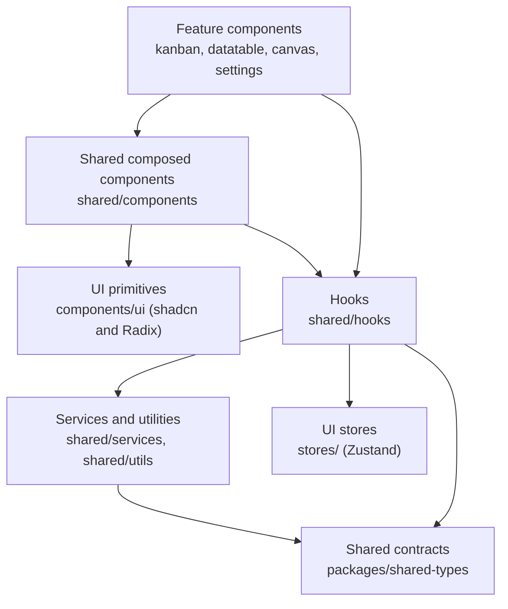
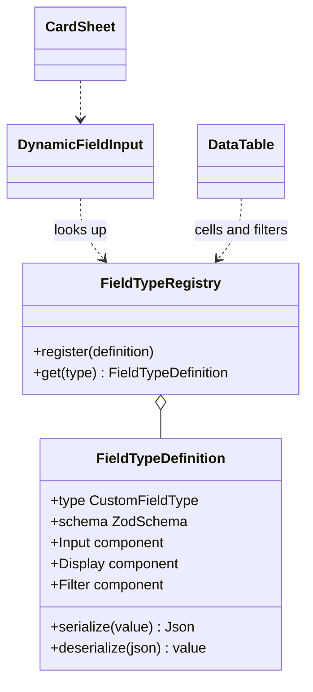
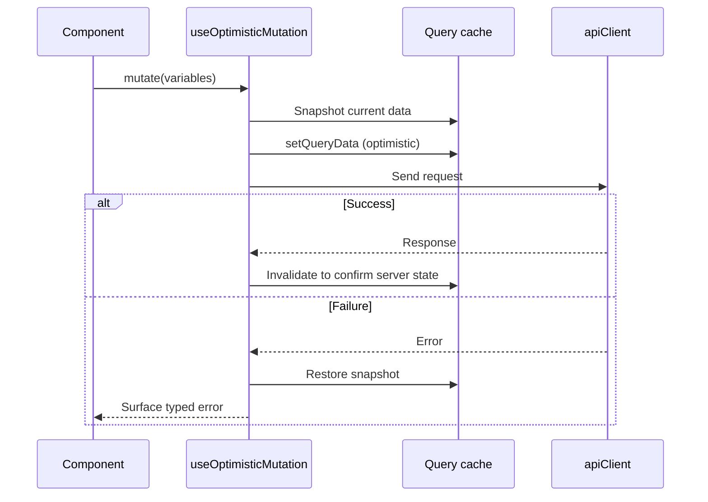

# UI Component Architecture

**System:** Collaborative Real-Time Workflow & Kanban Suite
**Status:** Draft v0.1
**Scope:** `apps/web`
**Related documents:** [README](../README.md) · [Technical Architecture Document](technical-architecture.md) · [Roadmap](roadmap.md)

This document defines the shared components, hooks, and services of the web application, where each one lives, and the rules that govern how features use them. The goal is that common behavior is built once, and a new feature is added by composing existing parts or registering a new entry, not by editing shared code.

> Names below are the proposed catalog. Build items when a feature first needs them, in the order given in [section 9](#9-build-order).

---

## 1. Principles

1. **Compose, don't fork.** Features compose shared components. If a feature needs a variation, extend the shared component's API instead of copying it.
2. **One owner per concern.** Server state belongs to TanStack Query, UI-only state to Zustand, and form state to React Hook Form. Nothing is duplicated across them.
3. **Open for extension, closed for modification.** Field types, palette commands, and canvas node types are registries. Adding one means adding an entry.
4. **UI gating is a convenience, not security.** Hiding a control based on role improves usability. The server still enforces every permission.
5. **Server Components by default.** Use Client Components only for interactivity. Shared components that need state or effects are marked `"use client"` individually, and pure display components stay server-compatible.
6. **Depend on abstractions.** Components receive data and callbacks through props or hooks, and do not import the API client or socket directly. This keeps them testable and reusable.

---

## 2. Layering and Dependency Rules



Rules:

- Dependencies point downward only. A primitive never imports a shared component, and a shared component never imports a feature component.
- Features may not import from each other. Anything two features need moves down into `shared/`.
- Only `shared/services/apiClient` and `shared/services/socketClient` talk to the network. Components reach them through hooks.
- `components/ui/` is generated by shadcn. Customize through composition in `shared/`, not by editing those files.

---

## 3. Directory Map

```
apps/web/
├── app/               # Thin route files that only compose feature containers
├── components/
│   ├── ui/            # shadcn primitives (generated, never edited)
│   ├── auth/          # Feature: login and register
│   ├── workspace/     # Feature: workspace create, members, invite
│   ├── kanban/        # Feature: board, column, card
│   ├── datatable/     # Feature: board table view
│   └── canvas/        # Feature: automation node canvas
├── shared/            # Everything reusable across features
│   ├── components/    # Composed presentational components (+ layout/, data/, real-time/)
│   ├── hooks/         # Reusable hooks
│   ├── services/      # apiClient, session, registries, queryKeys, permissions
│   └── utils/         # Pure helpers (cn, formatters)
└── stores/            # Zustand UI state
```

`shared/` is an addition to the base structure in the README and replaces the former top-level `lib/` and `hooks/`.

### Container and presentational split

Each screen has one thin **container** in its feature folder. It calls hooks, handles loading and error branching, and passes plain props down. Everything below it is **presentational**: typed props in, JSX out, no fetching, no API client, no business rules. The API owns the data contract, so containers pass DTOs through unchanged. If a screen needs a different shape, the endpoint and its shared Zod schema change, not the client.

---

## 4. Component Catalog

### 4.1 UI primitives (`components/ui/`)

`Button`, `Dialog`, `Sheet`, `Select`, `Command`, `DropdownMenu`, `Popover`, `Tooltip`, `Tabs`, `Checkbox`, `Input`, `Textarea`, `Badge`, `Avatar`, `Skeleton`, `Toast`.

### 4.2 Identity and display (`shared/components/`)

| Component | Purpose | Reused by |
| --- | --- | --- |
| `UserAvatar` | One avatar with initials fallback | Cards, comments, presence, members |
| `AvatarStack` | Overlapping avatars with a "+N" overflow | Presence bar, card assignees |
| `UserPicker` | Searchable workspace-member selector | Assignee, `USER` custom field, invites |
| `PriorityBadge` | Single source of priority colors and labels | Card, table, filters |
| `TagChip` | Tag rendering | Card, table, filters |
| `RoleBadge` | Display for `OWNER`, `ADMIN`, `MEMBER`, `VIEWER` | Members list, invites |
| `RelativeTime` | Relative time with full timestamp on hover | Comments, activity feed |
| `EmptyState` | Icon, message, optional action | Any list or board |
| `ErrorState` | Retryable error that understands `{ message, code }` | Any data-loading view |

### 4.3 Inputs and editing (`shared/components/`)

| Component | Purpose |
| --- | --- |
| `DatePicker` | Date selection for due dates and `DATE` fields |
| `PriorityPicker` | Selection of `LOW` through `URGENT` |
| `TagMultiSelect` | Apply and remove tags |
| `InlineEditable` | Click-to-edit with save and cancel, shared by card titles and table cells |
| `RichTextEditor` | Description and comment editing |
| `SafeRichText` | Sanitized rendering of stored rich text |
| `FileDropzone` | Upload with type and size validation, progress, and error states |
| `ConfirmDialog` | The single confirmation pattern for destructive actions |
| `FormField` | React Hook Form and Zod wrapper providing label, hint, and error display |
| `DynamicFieldInput` | Renders the right input for a `CustomFieldType` (see [section 5.1](#51-field-type-registry)) |

### 4.4 Layout and navigation (`shared/components/layout/`)

| Component | Purpose |
| --- | --- |
| `AppShell` | Page frame, sidebar, and header slots |
| `Sidebar`, `PageHeader`, `Breadcrumbs` | Navigation and page chrome |
| `WorkspaceSwitcher` | Switch the active workspace |
| `CommandPalette` | `Cmd+K` palette driven by a command registry (see [section 5.2](#52-command-registry)) |
| `PermissionGate` | Renders children only if the role allows the capability |

### 4.5 Data display (`shared/components/data/`)

| Component | Purpose |
| --- | --- |
| `DataTable` | Generic TanStack Table wrapper with sorting, filtering, column visibility, pagination, and CSV export |
| `FilterBar`, `FacetFilter` | Reusable filtering controls |
| `VirtualList` | Virtualization for long lists and large boards |
| `ActivityFeed` | Renders `ActivityLog` entries for a card or workspace |
| `ProgressBar` | Checklist and completion progress |

`DataTable` is generic over its row type and column definitions. The board table view, members list, automation rule list, and audit log all use it.

### 4.6 Real-time (`shared/components/real-time/`)

| Component | Purpose |
| --- | --- |
| `PresenceAvatars` | Who is on this board now |
| `CursorLayer` | Live cursors, throttled and ephemeral |
| `FieldLockIndicator` | Wraps a field and shows who holds its lock |
| `ConnectionStatus` | Connected, reconnecting, or offline |

---

## 5. Extension Registries

Registries are the main mechanism for open/closed behavior. Each maps a key to a self-contained entry object, and consumers look entries up instead of branching on the key.

### 5.1 Field type registry

Location: `shared/services/fieldTypeRegistry`.



`DynamicFieldInput`, table cells, and filters all resolve behavior from the registry. Adding a field type means registering one definition. The server keeps a matching handler so validation is enforced on both sides from the same Zod schema in `packages/shared-types`.

### 5.2 Command registry

Location: `shared/services/commandRegistry`.

Features register commands (id, label, group, keywords, permission, handler) when they mount. `CommandPalette` renders whatever is registered and filters by the user's permissions. No central list is edited when a feature adds a command.

### 5.3 Canvas node registry

Location: `components/canvas`.

Each trigger and action node type registers its component, default configuration, configuration form, and Zod schema. The canvas builds its node-types map from the registry. This mirrors the server-side trigger and action registries so a new rule type is added in matching places on each side.

---

## 6. Shared Hooks (`shared/hooks/`)

| Hook | Purpose |
| --- | --- |
| `useOptimisticMutation` | Wraps a mutation with snapshot, `setQueryData`, rollback on error, and invalidation on settle |
| `useSocket`, `useRoom` | Connection and room lifecycle with cleanup |
| `usePermissions` | Capability checks for the current user and workspace |
| `useCurrentWorkspace` | The active workspace and the user's role in it |
| `useDebouncedValue`, `useThrottledCallback` | Search input and cursor updates |
| `useKeyboardShortcut` | Registered, conflict-aware shortcuts |

### Optimistic mutation flow

Every drag-and-drop action and inline edit uses `useOptimisticMutation`, so the rollback behavior required by the project rules is implemented once.



---

## 7. Services and Utilities (`shared/services/`, `shared/utils/`)

| Module | Responsibility |
| --- | --- |
| `apiClient` | Typed fetch wrapper that attaches auth, parses the standard error shape, and validates responses with Zod |
| `queryKeys` | Central factory for TanStack Query keys. Keys are never written inline |
| `lexorank` | Midpoint, before, after, first, last, and compare for fractional positions |
| `socketClient` | Typed Socket.io client built on the `shared-types` payload definitions |
| `permissions` | Role-to-capability map used by `PermissionGate` and `usePermissions` |
| `format` | Dates, numbers, file sizes, and pluralization |
| `fieldTypeRegistry` | See [section 5.1](#51-field-type-registry) |
| `commandRegistry` | See [section 5.2](#52-command-registry) |

`permissions` should be derived from the same capability definitions as the server's RBAC matrix, ideally exported from `packages/shared-types`, so the two cannot drift.

---

## 8. Conventions

### 8.1 Component contract

- Props are typed interfaces with no `any`. Components do not accept untyped payloads.
- Components are controlled where practical (`value` and `onChange`), so they work with React Hook Form and with optimistic state.
- Every component handles loading, empty, and error states, either itself or through documented props.
- Display components carry no data fetching. Data arrives through props or a hook.

### 8.2 State

- Server data: TanStack Query only.
- UI-only state (sidebar collapse, view mode, cursor coordinates): Zustand only.
- Form state: React Hook Form with a Zod resolver.
- Never copy server data into Zustand.

### 8.3 Accessibility

- Interactive components expose correct roles, labels, and keyboard behavior as part of their contract, not as later polish.
- Focus is managed on open and close for dialogs, sheets, and the command palette.
- Drag-and-drop provides a keyboard alternative and announces moves through a live region.

### 8.4 Documentation and testing

- Every file has a header comment, and every exported component and hook has a TSDoc block covering props, behavior, and side effects.
- Shared components have unit tests covering states and accessibility attributes.
- Registry entries have tests proving validation, serialization, and rendering for each type.

### 8.5 Promotion rule

A component starts inside the feature that first needs it. When a second feature needs it, move it down to `shared/` in the same change that adds the second use.

---

## 9. Build Order

1. **Core plumbing:** `apiClient`, `queryKeys`, `FormField`, `ConfirmDialog`, `EmptyState`, `ErrorState`, `UserAvatar`.
2. **Board foundations:** `lexorank`, `useOptimisticMutation`, `PermissionGate`, `usePermissions`, `permissions`, `DataTable`.
3. **Real-time:** `socketClient`, `useSocket`, `useRoom`, `PresenceAvatars`, `CursorLayer`, `FieldLockIndicator`, `ConnectionStatus`.
4. **Card details and custom fields:** `fieldTypeRegistry`, `DynamicFieldInput`, `InlineEditable`, `RichTextEditor`, `FileDropzone`, `ActivityFeed`.
5. **Automation:** the canvas node registry and its node components.
6. **Navigation:** `CommandPalette` and `commandRegistry` start in Stage 1 as a shell and grow as features register commands.

This order lines up with the stages in the [Roadmap](roadmap.md).
